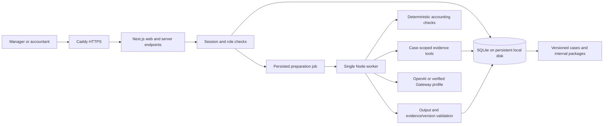

# Application architecture

Implementation status, October 31, 2026. Read with the [implementation plan](implementation-plan.md), [local runbook](local-runbook.md), [production runbook](../infra/deploy/README.md), and [UI guidelines](ui-guidelines.md). All four screens, authenticated server endpoints, durable SQLite workflow and frozen report packages are implemented. The public reviewer deployment runs on the existing DigitalOcean droplet at `asset-living-demo.foresyte.xyz`; Azure is not part of the application runtime.

Local verification passed TypeScript, ESLint, 42 unit tests, the full browser workflow and the native Next.js production build. All four desktop/phone screens and targeted dark-theme, 125% zoom, reduced-motion and keyboard/focus states were checked; partial progress, phone package actions and dialog focus were corrected and rechecked. The Linux image confirmed Node.js 24.22.2 and SQLite 3.53.4. Authenticated container login/source counts, worker preparation and persistence after web restart also passed: one import and 67 cases survived, with 51 rule-only preparations complete in that earlier isolated check. The current full run subsequently completed all 67 cases, including 16 live semantic drafts, with no run error. The earlier Linux image built successfully; the final Linux image rebuild passed. Account/model access, a live Case review tool loop and a live four-case package summary now passed.

## Selected stack

| Concern | Build baseline |
| --- | --- |
| Runtime and package management | Node.js 24 LTS, pnpm, committed lockfile |
| Web application and endpoints | Next.js 16 App Router, compatible React 19 release, strict TypeScript; Node runtime for database/auth/import endpoints |
| UI | Tailwind CSS 4, selected shadcn/ui primitives, Lucide icons; apply ui-craft throughout implementation |
| Workbook intake and validation | ExcelJS and Zod; immutable original files and sheet/row references |
| Persistence | SQLite with better-sqlite3 13.x, stable Drizzle ORM 0.45.x and Drizzle Kit migrations |
| Authentication | Better Auth with its SQLite/Drizzle adapter, two seeded demo accounts, public signup disabled |
| Authorization | Server-validated manager/accountant role permissions and expected-version checks on mutations |
| Preparation and agent | One separate TypeScript/Node worker, persisted SQLite jobs, bounded application-controlled evidence tools |
| LLM integration | Official OpenAI JavaScript SDK and Responses API; configured `gpt-6.1-sol`. Catalog capabilities, account access and selected live application features verified; full worker preparation verified at 67/67. Azure AI Gateway remains a future capability-checked profile, not a tested active provider |
| Reports | Compact print-ready HTML, browser Print/Save as PDF, case CSV; full audit/source details outside the default report |
| Verification | Vitest, Playwright, TypeScript and ESLint |
| Delivery | CI-built Linux image; Next.js web/API and one worker on the shared DigitalOcean droplet behind Caddy, with a persistent host bind mount |

Exact installed dependencies are recorded in `package.json` and `pnpm-lock.yaml`: Next.js 16.4.3, React 19.3.1, Better Auth and its Drizzle adapter 1.7.14, better-sqlite3 13.0.3, Drizzle ORM 0.45.4 and OpenAI SDK 7.47.0. Node 24 is the supported baseline; the checked Linux runtime is 24.22.2. The foundation uses stable Drizzle, not its 1.0 prerelease path. GitHub Actions builds the `linux/amd64` release image and deploys its commit tag through SSH.

## Composition and ownership

Use one project with separate web and worker entry points. Shared domain contracts own money, evidence identity, correction treatment, case transitions and package invariants. The web server and worker call those contracts; UI components display the result and submit intended actions rather than implement accounting authority.

Keep modules aligned with their responsibility: screens and handlers; accounting/domain contracts; import and source storage; database schema/migrations and queries; jobs/worker; provider integration; authentication; report snapshots and rendering. Extract shared components where behavior is genuinely common. A generic platform, dual SQLite/PostgreSQL implementation, separate Python service, vector database, Redis queue and managed agent hosting are not required for this workflow.

The diagram shows both the local and deployed process boundary. Development binds loopback port 3000; production exposes only shared Caddy, which reaches the web container over an external Docker network. Local startup and container commands are in the runbook.

## Persistence and source integrity

Store integer cents for money and retain raw source precision, original identifiers, workbook hash, import identity, policy version, sheet/range and scenario clock. The intentionally public `seed/close-pack.xlsx` is packaged as the empty-database baseline. Startup imports it without starting preparation; manual uploads can replace the active source, while reset restores the first archived baseline. Original workbook records remain immutable. Supplemental support has attributable authorship, period, source type, immutable content/version and explicit demonstration provenance where applicable.

Separate proposal review, evidence sufficiency, execution, verification and issue resolution. A decision refers to the exact proposal and evidence version. Apply expected-version checks on server mutations and worker commits so an older request or model response cannot overwrite newer support or review. Idempotency applies to imports, run creation, job claims, evidence additions and review submissions.

Reviewed packages preserve materialized scope, register, included wording, unresolved actions and reviewer metadata together with references to immutable case/source versions. Historical output is rendered from that frozen content, not reconstructed from mutable current cases. UI state and a successful model response cannot substitute for persisted review records.

## SQLite placement and concurrency

- Development: a configurable, gitignored path such as `data/asset-living.sqlite` inside the checkout.
- Production: `/home/deploy/asset-living-close/data` on the droplet, outside the checkout and container image. Web and worker bind-mount the same whole local directory, including WAL/shared-memory files and immutable uploads. Only the public empty-database baseline is packaged in the image.
- Use WAL, a busy timeout and short transactions. Keep database connections on the same host; a network share is unsuitable for this WAL topology.
- Never hold a database transaction open while waiting for a model. Validate job ownership and expected evidence/case versions immediately before committing a result.
- Run schema migrations once during controlled deployment. Keep source-controlled migrations and synthetic seed definitions separate from mutable runtime data.

The actual Linux driver probe returned SQLite 3.53.4. Keep the `sqlite_version()` startup check rather than relying on the host executable: SQLite documents a WAL-reset concurrency issue affecting versions through 3.51.2, fixed in 3.51.3 and later with selected backports. The installed better-sqlite3 13.0.3 therefore uses a patched engine in the checked image.

## Jobs and bounded preparation

The web server records a job and returns without waiting for the complete preparation run. One worker atomically claims eligible jobs with a lease/heartbeat and saves stage/case results. A worker restart can recover expired work without duplicating a manager decision or an already-persisted result. Cancellation, retries and late responses must recheck ownership and version context before writes.

Run deterministic checks across applicable supplied records before model interpretation. Preserve calculated findings when drafting fails. Present substantive stage progress and actionable errors; keep full tool activity in details rather than the main workflow.

Start with configurable limits of six tool calls and one schema-repair attempt per case, explicit timeout/output limits, and bounded job retries. Record incomplete outcomes honestly when a limit is reached. This is one bounded investigation loop, not a requirement for a multi-agent framework.

## Provider boundary and LLM authority

OpenAI Responses is implemented through the official JavaScript SDK with the configured `gpt-6.1-sol` model preserved. The application supplies selected snapshot/case context, calculated facts, source IDs and allowed tools. It executes permitted tool requests, validates results and persists the typed draft or evidence request. Permitted tools retrieve relevant property, account, invoice, variance, close and supplemental evidence records. They do not expose arbitrary SQL, shell, posting, payment, budget or message-sending authority.

The configured identifier `gpt-6.1-sol` is documented for Responses, function calling and structured outputs. After configuration correction, the key authenticated; the account model list included this identifier and retrieval returned HTTP 200. The actual application Case review tool loop returned HTTP 200, cited two sources and retained the supported $2,214.16 grounds amount without an unsupported JE. A live package summary also returned HTTP 200 across all four Sunset Ridge cases; its latest version was 42 words in two sentences without internal status IDs. These are actual application/provider checks, separate from injected-transport/browser tests. The corrected three-case live evaluation also passed mechanical checks and separate Codex qualitative review, including unsupported-duplicate and capital-policy gaps; see the implementation plan for its support-identity discovery and fix. The full worker run is verified: Submitted, 67/67 complete, no run error, with 16 live semantic drafts and 51 rule-only preparations.

Earlier HTTP 401 `invalid_api_key` and HTTP 429 `credit_balance_exhausted` responses remain useful recovery examples, not current blockers. Preserve the corrected model and keep credentials outside tracked files; restart web and worker after credential changes. A future provider failure must retain findings and manual review without substituting canned live output.

The Azure AI Gateway remains a permitted future provider route. Enable it only after checking endpoint, authentication, protocol, model/deployment identifier, function calling, schema support, timeout behavior and usage reporting. Do not assume a base-URL change implements the required API. OpenAI is the selected active configuration; the gateway has not been configured or tested.

Validate amounts, source existence, case scope, policy references and output fields in code. A valid schema does not establish the truth of a causal explanation. The LLM interprets varied descriptions and attributable support, proposes specific follow-ups and revises supported wording. It cannot invent settlement, approval authority or posting dates. New support reopens affected review rather than silently confirming the model's earlier result.

Variance cases carry the property's AP rows for the category as original evidence, with computed count, total and out-of-period dates. The variance prompt asks the model to describe those rows and frame timing or completeness as questions; citation and amount checks still cannot validate causal claims, so manager review remains required.

The manager priorities briefing (`src/server/briefing.ts`) is a structured-output request over facts computed in `src/server/operations.ts`. AI chooses priorities by selecting code-owned fact identifiers and compatible next-action identifiers. Code renders the factual sentences and their source links; the response cannot supply free-text counts, names, properties or amounts. Unknown identifiers, incompatible actions and length overruns receive one bounded repair. The validated briefing is stored as an import-scoped agent-activity record keyed by a fingerprint of the facts, prompt version and model, so it is drafted once per review state and refreshed when that state changes. Concurrent requests share one draft, and the reset-generation guard rejects late writes. `GET /api/operations` and `POST /api/operations/briefing` are manager-only; accountants receive the non-comparative attention facts through `/api/workspace`.

Record provider/model, prompt version, evidence versions, necessary tool activity, latency and returned usage. Keep secrets server-side and outside tracked files. Distinguish live output from fixtures in configuration, internal provenance and documentation; D020 removes fixture labels from the interface. A live-mode outage cannot silently become a successful canned response.

## Authentication and review permissions

Better Auth email/password sessions, its Drizzle SQLite adapter and two controlled local accounts are implemented. Public signup is disabled; credentials remain in ignored local/deployment configuration. No SSO, email delivery or user-administration console is included. Auth schema and migrations use the selected stable package/adapter versions; the integration retains the stable Drizzle Relations v1 path.

Sessions and role permissions are enforced on protected server endpoints. Manager permissions cover review/approval and resolution; accountant permissions cover evidence and execution records. The browser workflow includes cross-role rejection. Cookie presence or hidden buttons alone are not authorization. Local identities and configured workflow authority do not establish employer authorization to transact in an external accounting system.

## Report and audit presentation

The normal report has a short property/period/version header, an optional concise accepted summary and one case/action table. That table includes open items and responsible next actions; do not repeat it in a second outstanding-work appendix. Keep concise uncertainty and approved-versus-executed state visible.

Source links open evidence where needed. Store full provenance and expose it through Audit details or a separate audit download, rather than placing a source manifest in the primary preview. Print-ready HTML and CSV render the frozen package; browser Print/Save as PDF avoids a server-side browser/PDF service. These are internal accounting handoffs, not complete owner financial statements.

## Production delivery

GitHub Actions builds the `linux/amd64` image and publishes commit and `latest` tags to GHCR. The deploy job copies the production Compose file over pinned-key SSH, pulls the immutable commit tag, recreates web/worker, waits for health, and verifies the public application plus existing droplet services.

The web container is limited to 320 MiB and the worker to 384 MiB. Neither binds a host port. Shared Caddy terminates HTTPS for `asset-living-demo.foresyte.xyz` and proxies to the web container over `foresyte_default`. SQLite, WAL/shared-memory files, uploaded workbooks, archives, and manual backups remain under the persistent host data directory.

This is a deliberately inexpensive single-host reviewer deployment, not a high-availability architecture. Consistent scheduled off-host backup and restore/reboot rehearsal remain operational follow-up work. Existing PostgreSQL remains a future alternative if hosting or concurrency requirements change, not a second backend to build now.

## Primary sources checked October 31, 2026

- [Next.js support policy](https://nextjs.org/support-policy): 16.x Active LTS and supported-release guidance.
- [Node.js release status](https://nodejs.org/en/about/previous-releases): Node 24 remains LTS; Node 26 is also LTS.
- [Next.js self-hosting](https://nextjs.org/docs/app/guides/self-hosting): reverse proxy and runtime environment configuration.
- [Drizzle SQLite adapters](https://orm.drizzle.team/docs/sqlite/get-started-sqlite) and [stable 0.45.4 release](https://github.com/drizzle-team/drizzle-orm/releases/tag/0.45.4): SQLite integration and stable versus prerelease selection.
- [better-sqlite3 releases](https://github.com/WiseLibs/better-sqlite3/releases): current driver releases and embedded SQLite updates.
- [SQLite WAL](https://sqlite.org/wal.html) and [Online Backup API](https://sqlite.org/backup.html): local-host WAL constraints, patched engine requirements and consistent backup.
- [Better Auth Next.js integration](https://better-auth.com/docs/integrations/next), [Drizzle adapter](https://better-auth.com/docs/adapters/drizzle), [email/password](https://better-auth.com/docs/authentication/email-password) and [stable releases](https://github.com/better-auth/better-auth/releases): sessions, SQLite adapter, signup configuration and compatible stable-package selection.
- [Configured model catalog](https://developers.openai.com/api/docs/models/gpt-6.1-sol): documented Responses, function-calling and structured-output capabilities. Account access and selected live application responses were separately verified.
- [OpenAI function calling](https://developers.openai.com/api/docs/guides/function-calling#the-tool-calling-flow) and [structured outputs](https://developers.openai.com/api/docs/guides/structured-outputs): application-controlled tools and schema-constrained output.
These sources establish product capabilities and constraints. Completed local and production checks are recorded above and in the implementation plan; source documentation alone is not evidence of application verification.
