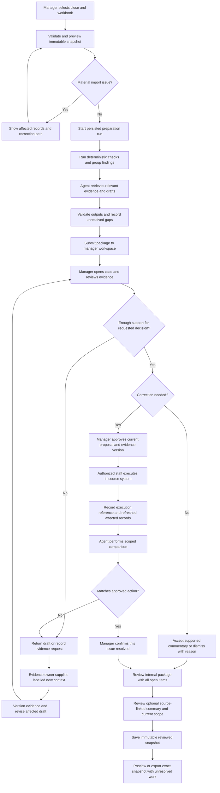

# Screens and end to end workflow

Implementation status, October 31, 2026. The four screens now run as a connected local application at `http://127.0.0.1:3000`, with sessions/server roles, SQLite preparation jobs, versioned evidence/corrections and frozen reports. Follow the [local runbook](local-runbook.md) for startup and current role-based workflow. The [implementation plan and status](implementation-plan.md) records completed checks and remaining provider/deployment work.

The design material below preserves the agreed behavior and historical walkthroughs. Current preparation has 67 findings; Sunset Ridge has four, including approval evidence. Its earlier three-issue illustration is not the current complete property scope. The native/browser/unit and local Linux container workflow checks passed; this does not convert earlier mockup captures into actual-application UI verification. Actual all-four-screen desktop/phone checks and targeted dark-theme, 125% zoom, reduced-motion and keyboard/focus checks passed; this is bounded verification rather than every possible state. OpenAI account access, an actual Case review tool loop and a package-summary call now passed. The full worker run is verified: Submitted, 67/67 complete, no run error, with 16 live semantic drafts and 51 rule-only preparations. Azure remains future work.

[UI rules](ui-guidelines.md) govern the implemented product and supersede redundant historical preview copy.

## Product focus

The Property Accounting Manager is the primary reviewer; staff accountants are also explicit Scenario B users. The interface should answer what needs a decision, why it matters, what evidence supports it, who supplies or executes the next action, and what remains unresolved. Avoid making the manager navigate a technical agent console to do accounting work.

Use four main screens. Source previews, property details, run history, and agent activity are contextual drawers or panels. A separate accountant application and CFO console are not proposed for the initial workflow.

## Screen map

| Screen | Main question | Essential content | Primary actions |
| --- | --- | --- | --- |
| 1 Close workspace | Which properties need intervention, and what happens next? | Period and scenario day; selected snapshot; property-by-eight-step progress; source-reported completion; overdue work, evidence gaps, responsible accountants, and a selected-property AI handoff. | Filter properties; select a property or close step; inspect source and preparation scope; open the relevant case; prepare review; open review package. |
| 2 Prepare review | What source and scope will be prepared, and what has finished? | Selected workbook and counts; September/BD6 context; blocking errors versus warnings; available/missing support; staged code/agent/LLM work; preserved findings and partial output. | Select/preview source; confirm scope; start; inspect notices; cancel/resume; retry failed drafting; open workspace. |
| 3 Case review | What does the evidence support, which correction route applies, and what remains to be done? | Original facts; stable source IDs; internal requests; attributable support separated from records; versioned analysis and Proposed correction panel; manager decision; source-system execution reference; scoped verification. | Inspect sources; record request/support; have agent revise; review current proposal; return with a reason or approve the action; record execution/refreshed evidence; run scoped check; confirm this issue's resolution; inspect history. |
| 4 Review package | What was reviewed, what remains open, and which version are we handing off? | Mandatory structured case register; separate approval/execution/verification states; correction refs; optional source-linked handoff summary; source/run/case versions; current draft versus reviewed internal snapshot. | Inspect cases/sources; revise/edit/compare/accept summary; acknowledge scope and open items; save reviewed snapshot; preview export; inspect history; return to Case review. |

The property-first workspace is the default landing page. Prepare review is a task flow; Case review is reached from a property's issue or step. Review package is the output view. Do not require the manager to visit every screen to inspect an existing case.

## Navigation and context

Keep the selected close period, scenario clock, snapshot, and latest run status visible across screens. A newly imported snapshot does not overwrite the previous one. Show when the displayed package or decision belongs to earlier evidence.

Expose source evidence directly beside each claim. Put technical details such as model version, token usage, and tool activity under a How this was prepared panel, available for the interview and troubleshooting without cluttering the normal review task.

## Case review layout

The Case review screen has three coordinated areas:

1. Facts and evidence: relevant invoice pairs, chart of accounts and close context, original source locations, supplemental support, and conflicting/missing information.
2. Proposed correction: versioned source-linked analysis, prerequisites, recommended import/invoice/AP/reclass route, conditional JE lines where supported, and historical proposals. Show which claims came from the workbook versus later support.
3. Handoff and review: internal request, staff evidence return, agent revision, manager review, execution reference, refreshed evidence, scoped check, and issue resolution.

Keep review disposition, evidence sufficiency, unresolved follow-up, execution, and resolution separate. Approval of an action does not establish execution. Accepting wording does not supply missing support. Source Complete status remains an imported fact, not a fact the agent can rewrite. Actor labels describe the walkthrough rather than authenticated role switching.

## Review package layout

Screen 4 provides an internal accounting handoff, not complete owner financial statements. Keep period/property scope and package version in the header, an authoritative case/action register in the main area, an optional concise handoff summary, and manager review/snapshot actions. Case/source details, full provenance and the return handoff are contextual views. The default report uses one case/action table without a repeated outstanding-work appendix or full source manifest.

The illustrative Sunset Ridge continuation starts with Labor resolved using simulated execution/check references, Grounds approved but not executed, and Office awaiting evidence. This fixture is not imported from the user's actual Screen 3 state. All three cases remain included; open items are not optional. Do not total their amounts as savings or mark the property closed.

The manager can inspect sources, revise or edit summary wording, accept the current wording, acknowledge the current scope including open items, and save an immutable reviewed internal snapshot. Summary acceptance, package review, correction approval and issue resolution are separate. A package can be reviewed with outstanding work if that work remains explicit. Preview export shows exact selected contents; the static preview generates no PDF or download.

New substantive case updates make the current draft's summary stale and clear package acknowledgement. The preview applies simulated Grounds execution-pending-verification and later resolution updates, with Office still open. Historical snapshots retain their captured content and versions. The LLM drafts or revises synthesis inline; code owns statuses, counts, amounts, mandatory inclusion, version gates and snapshot creation. A model outage leaves the register and manager editing available.

## End to end flow

Source-system execution is performed by an authorized person outside this prototype. The preview records simulated execution evidence; it does not post, pay, hold a payment, or send a message. New substantive evidence makes prior approval historical and requires revision/reapproval. Resolving one issue never automatically completes the property close.

## Worked demonstration sequence

1. Import the supplied workbook and show the business-day-6 context, including the date discrepancy instead of silently resolving it.
2. Start the preparation run. All applicable records pass through implemented checks; agent calls remain case-scoped and bounded.
3. Open Sunset Ridge from the manager workspace. Its first six close tasks are source-reported Complete and no B3 category exceeds 10%, yet it has two duplicate candidates and a coding-review finding.
4. Select StaffBridge's 5,017.79 candidate pair (B2 rows 15/296). Inspect the agent's source-linked match and targeted request; posting/payment state is initially unknown.
5. Have the staff accountant add supplemental support: distinguish the attributable explanation from invoice, AP/payment, period and authority records. Fixture origin remains internal metadata/documentation under D020; use normal product labels and display IDs. Earlier analysis becomes stale.
6. Have the agent revise. Under the default fixture, two posted unpaid bills represent one obligation; propose reversal of the exact extra bill through AP. The manager approves the current proposal and evidence version, not a generic standalone JE.
7. Have staff record simulated source-system execution and refreshed affected records. The agent performs a scoped check; the manager then confirms this issue's resolution. Show another issue remains open and original B3/B4 values remain unchanged.
8. Switch to the 2,214.16 grounds-maintenance coding issue (B2 row 424; B1 rows 7/12). Demonstrate a conditional manual reclass only under explicit simulated same-entity, open-period, approval policy. Switch to Office Depot's 502.34 pair (B2 rows 34/186) to show rejection of an extra unposted invoice, with no JE.
9. Demonstrate a missing-payment support packet blocking readiness and a conflicting refreshed record blocking resolution. Return a proposal with a reason; distinguish revising analysis against existing evidence from obtaining new facts.
10. Open Review package. Inspect Labor resolved, Grounds approved but not executed, and Office awaiting evidence, with normal operational statuses. Review/revise the optional source-linked summary; it cannot change register facts.
11. Acknowledge the package scope and all open items, save an immutable reviewed internal snapshot, and preview its exact export content. Apply a simulated case update to show the current draft needing renewed review while the prior snapshot stays unchanged. No owner delivery or complete-close certification is implied. Campus Edge and Aggie Commons remain proposed supporting examples.

The four-screen flow is selected, with a leaner [Review package](screens/review-package.md) and on-demand Audit details. Supplemental support, authority/period policy, decisions, execution and refreshed records are fixtures documented internally; D020 removes demo/simulation/harness labels from all product views. Previews make no LLM, accounting, messaging, database or authentication calls. The workflow requires contextual evidence and versioning, not a general document-management platform.

## Failure and edge states

| Situation | Expected user experience |
| --- | --- |
| Invalid amount, unknown property, or missing required sheet | Source-linked import issue; no silent dropped records or false successful run. |
| Model unavailable or invalid response | Calculated findings and saved work remain available; affected drafting is visibly unavailable or incomplete. Retry is bounded. |
| Page refresh during a run | Saved run state can be reopened without starting a duplicate job. |
| Worker restart or interrupted run | Recover or retry eligible work using persisted stage/case state; do not duplicate manager decisions. |
| New source snapshot or context | Affected drafts show changed evidence and require renewed review where necessary; history is preserved. |
| Case dismissed as a false positive | Require a reason and retain the original finding and decision. |
| Commentary accepted with missing causal support | Keep the evidence request open; acceptance of text does not imply the cause has been established. |
| Posting/payment state missing | Keep the correction proposal unready; request source support rather than infer state from Approved or Pending. |
| Manager returns a correction proposal | Record a reason, revise against existing support where sufficient, or request a new evidence packet for missing facts. |
| Correction approved, then substantive evidence changes | Preserve approval in history; mark the proposal stale and require renewed review before execution against it. |
| Execution recorded but refreshed evidence conflicts | Show the exact comparison failure and keep resolution blocked; execution is not proof of a successful correction. |
| One Sunset Ridge issue resolved | Keep other issues and the original property-close status separate; do not rewrite B3/B4 or claim savings. |
| Internal package contains unresolved items | Include all open cases and next actions. Review of this handoff does not waive them or certify owner-report readiness. |
| Case changes after a package was reviewed | Preserve the historical snapshot; make the current draft's summary/review stale and require renewed review. |
| Handoff-summary model unavailable | Keep register facts and manager editing usable; summary may be omitted without hiding open cases. |
| All implemented checks complete | State the completed review scope; do not label the books verified or imply bank/AR reconciliation was performed. |

## Proposed build acceptance criteria

- One complete import → preparation → staff evidence return → revised proposal → manager approval → recorded authorized execution → scoped check → manager-confirmed issue resolution → export path works with source-linked records.
- Finding grouping reduces repeated decisions and presents shared gaps with drill-down.
- Original records, new human context, and model-generated wording remain distinguishable.
- Manager approval is version-specific, execution is separately evidenced, and conflicting or missing support blocks the appropriate transition. All simulated records and policies are labelled in the walkthrough.
- Source amounts and policy checks remain usable independently of the model.
- Refresh, repeated preparation, and one controlled model failure preserve saved work and expose partial results honestly.
- Export carries review state and unresolved items rather than implying a completed accounting close.
- Package snapshots freeze exact scope, case/evidence versions, included wording and review; later updates never mutate historical contents. Optional AI wording cannot alter the structured case register.
- Apply the selected [stack and implementation plan](implementation-plan.md) and [UI rules](ui-guidelines.md) during each build slice. Patched dependencies and provider compatibility must be verified during implementation.
